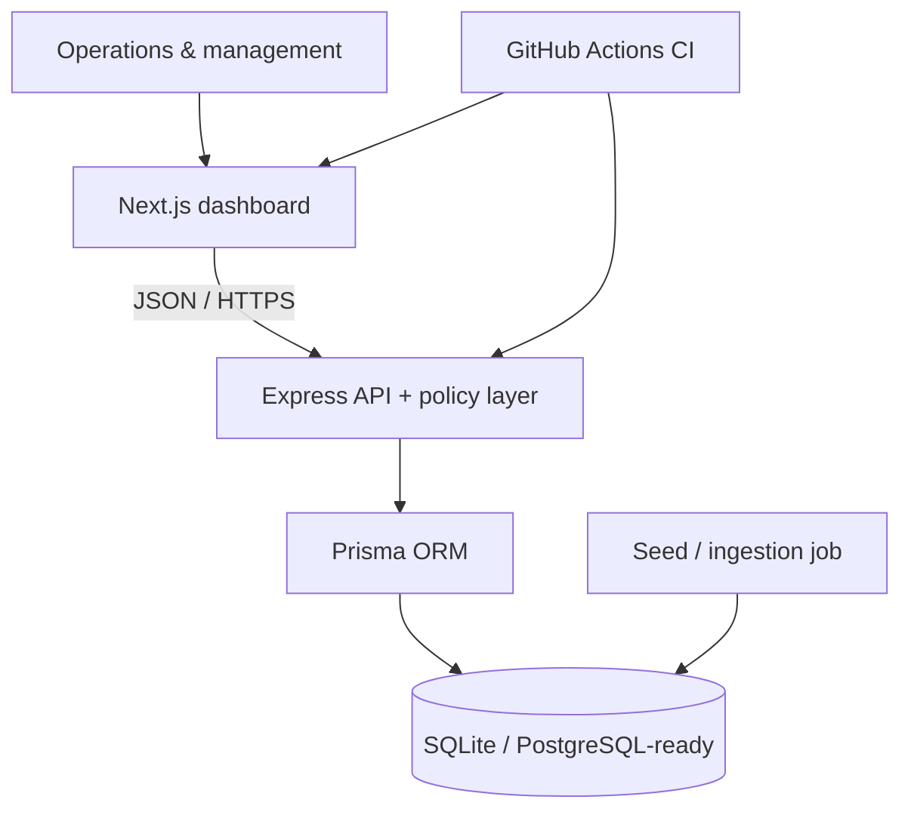

# Branch360: Enterprise Branch Analytics & SLA Dashboard

A full-stack operational dashboard for monitoring branch revenue, turnaround time (TAT), complaints, SLA risk, and actionable interventions.

This is deliberately built as an MVP product, not a chart-only mock-up: the dashboard exposes a documented intervention policy, separates commercial and operational health, has loading/error experiences, and ships with automated policy tests and CI.

## Live-simulated SQL demo

The application is intentionally transparent: it does **not** claim to use real bank or customer data. The `Simulate an event` control writes a new synthetic ticket and updates the database in a transaction; the dashboard reloads from SQL-backed rollups and records the execution in an ingestion audit table. The page clearly displays `SIMULATED LIVE` and data freshness.

The core portfolio query uses SQL common table expressions (CTEs), not frontend arithmetic. See [SQL analytics design](docs/SQL_ANALYTICS.md).

## Stack

- **Web:** Next.js 15, React, Tailwind CSS, Recharts, Lucide React
- **API:** Node.js, Express, TypeScript
- **Data:** SQLite with Prisma ORM

## Quick start

```bash
cp .env.example apps/api/.env
cp .env.example apps/web/.env.local
npm install
npm run db:generate
npm run db:seed
npm run dev
```

Open `http://localhost:3000`. The API runs at `http://localhost:4000`.

## API

All endpoints accept optional inclusive `from=YYYY-MM-DD` and `to=YYYY-MM-DD` query parameters. If omitted, the most recent 30 days in the data are used.

| Endpoint | Purpose |
| --- | --- |
| `GET /health` | Liveness check |
| `GET /api/dashboard/summary` | Aggregate revenue, TAT, active breaches, and open complaints |
| `GET /api/dashboard/branches` | Branch operational metrics and revenue versus target |
| `GET /api/dashboard/interventions` | Flagged branches and recommended corrective actions |
| `GET /api/dashboard/trends` | Daily complaint and exception trend series |

## Intervention rules

A branch is surfaced for intervention if either condition is met:

1. **SLA breach rate > 10%**
2. **Open complaints > 15**

When both conditions apply, the status is `Critical`; one condition yields `Warning`.

Branch health is a separate, broader operational label: a branch is `At risk` when it violates an intervention threshold, `Watch` when its TAT exceeds 36 hours or revenue achievement is below 90%, and `Healthy` otherwise. This prevents a good revenue number from hiding an operational failure.

## Product architecture



## What makes it portfolio-ready

- 5 branches, 150 daily performance records, and realistic operational tickets created deterministically over 30 days.
- Auditable ingestion runs and a live-simulation endpoint that demonstrates a real database write → SQL rollup → dashboard refresh path.
- Date-filtered executive KPIs, comparison charts, complete branch health portfolio, and a concise action matrix.
- Pure, unit-tested intervention policy so business thresholds are not hidden inside UI components or raw SQL.
- Typed API boundary, parameter validation, CORS configuration, health check, clean loading state, retry path, and error state.
- GitHub Actions validates the Prisma client, intervention rules, API compilation, and production web build on each pull request.

## Resume framing

> Built **Branch360**, a full-stack enterprise branch analytics MVP using Next.js, Express, Prisma, and SQLite. Designed a testable rules engine to identify SLA and complaint-backlog risks, with executive KPI, trend, portfolio-health, and intervention views; added automated CI and a 30-day deterministic data seed for reproducible demos.

## Data model and seed behavior

`npm run db:seed` recreates the local database with five Indian-region branches, 30 daily performance records per branch, and realistic tickets. Seeded ticket distributions intentionally create both warning and critical scenarios so the intervention table can be demonstrated immediately.
